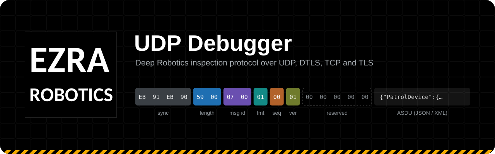

<p align="center">
  
</p>

**EZRA UDP Debugger** is a Postman-style tool for the Deep Robotics **Inspection Communication Protocol
V1.0.3** — the UDP/TCP (DTLS/TLS) interface robots like the Lynx S10 expose on `10.21.33.103`.
Send every documented command, watch the five status reports live, and run a conformance check that
tells you which parts of the docs actually work on *your* robot — all from a Mac, no ROS needed.

- **Backend:** Python (asyncio + FastAPI) — protocol codec, UDP / DTLS / TCP / TLS transports, heartbeat,
  reply matching, multi-packet reassembly, a mock robot and a CLI.
- **GUI:** Next.js, served by the backend as a static build (one process, works offline).
- **ROS 2 topics** (everything that is not UDP) are covered by a field guide:
  [docs/ROS2_TOPIC_DEBUG.md](docs/ROS2_TOPIC_DEBUG.md).

## Quick start (macOS)

Needs Python ≥ 3.10 and Node ≥ 20.

```bash
git clone git@github.com:DarmawanRobotics/drds_udp_tools.git
cd drds_udp_tools
make setup          # .venv + backend (editable) + web deps
make run            # builds the GUI, serves it on http://127.0.0.1:8765 and opens the browser
```

No robot nearby? One terminal is enough — this also starts a mock robot inside the same process.
Then pick a **Mock** preset in the top bar:

```bash
make demo           # = ezra-udp serve --mock-faults --open  (mock on UDP 30000 · DTLS 30004 · TCP 30001 · TLS 30003)
```

`make mock` still runs the mock on its own, e.g. to hit it from the CLI or from another machine.

Without `make`:

```bash
python3 -m venv .venv && source .venv/bin/activate
pip install -e "backend[dev]"
(cd web && npm ci && npm run build)
ezra-udp serve --open          # add --mock to get the built-in mock robot
```

## Connecting to the robot

| Preset | Transport | Port | When |
|---|---|---|---|
| Robot · DTLS | UDP + encrypted | 30004 | robot default |
| Robot · TLS | TCP + encrypted | 30003 | robot default, easiest fallback if DTLS is blocked |
| Robot · UDP plain | UDP | 30000 | only after encryption is disabled in the robot's `robotserver` config (port assumed — verify) |
| Robot · TCP plain | TCP | 30001 | same |

1. Put the Mac on the robot network and `ping 10.21.33.103`.
2. Not sure which mode is enabled on this unit? `make probe` (or **Test run → Probe** in the GUI) sends one
   heartbeat over DTLS 30004, TLS 30003, UDP 30000/30004 and TCP 30001/30003 and tells you which one answers.
3. Pick a preset (or press **Use** on a probe result), **Connect**. The heartbeat starts automatically
   (2 Hz; the docs require ≥ 1 Hz). If ACKs stop for 3 s the top bar turns red: **Link lost**.
4. The top bar shows **HB acked/sent** and **Reports** — the robot only pushes status reports to the
   address that keeps sending heartbeats.

Certificates: verification is off by default (robots ship self-signed certs). CA, client cert/key, SNI,
cipher list, DTLS MTU and **compat mode** (old TLS/DTLS versions, weak ciphers) are in the connection settings
(⚙ next to the format switch). Handshake errors say what to try next (plain port, certificate, compat).

## What's in the GUI

| View | What it does |
|---|---|
| **Requests** | Every command from §1.2 and §1.4 as a form generated from the docs. Live byte ribbon of the 16-byte header + ASDU, raw body mode, header overrides (wrong msg id / version / length / sync) to probe error handling, stream at N Hz, hold-to-move for axis/velocity commands. Reply with decoded labels, raw text, hex, header and a timeline (late replies such as finished navigation tasks are appended). |
| **Monitor** | Instruments for the five reports: robot state, attitude & heading, velocities, 16 joints with motor/driver temperatures, battery, CPU per core (locomotion & navigation hosts), GPS, navigation status with a pose trail, active faults. Each panel shows measured vs documented rate. |
| **Traffic** | Every packet in and out with filters (requests, reports, heartbeat, streams, problems only), detail pane with bytes and decoded JSON, export to JSON, engine log (handshakes, ICMP errors, fault changes). |
| **Test run** | Conformance checks: link, heartbeat ACK, the five report rates, the three query replies, E003 / E002 / E004 error paths, XML support — plus opt-in *caution* and *motion* checks. Export as Markdown or JSON. |
| **Bytes** | Decode hex captured with Wireshark/tcpdump, or build the exact APDU for any command (copy as hex, C bytes or a netcat one-liner). |

**Safety.** Commands that move the robot are marked with a hazard edge and are blocked until the top bar
switch is set to **Armed** (it always starts **Locked**). **Stop** (or `Esc`) stops every stream, sends zero
axis + zero velocity and cancels navigation. **E-STOP** does the same and then sends the soft emergency stop
(`MotionParam = -2`, joint damping). Keep the physical E-stop within reach anyway.

## CLI

```bash
ezra-udp probe --host 10.21.33.103                # which mode/port answers? (exit 0 = something answered)
ezra-udp list                                     # every command + report with Type/Command
ezra-udp send heartbeat                           # DTLS to 10.21.33.103:30004 by default
ezra-udp send location_get -t tls
ezra-udp send gait --items '{"GaitParam": 4097}' -t udp --port 30000
ezra-udp send motion_state --items '{"MotionParam": 1}' --yes      # moves the robot: needs --yes
ezra-udp listen -s 10                             # heartbeat + print reports, then measured rates
ezra-udp suite --allow-caution --json report.json # conformance run
ezra-udp decode "eb 91 eb 90 59 00 07 00 01 00 01 00 00 00 00 00 7b 22 ..."
ezra-udp mock --faults --loss 0.05                # fake robot with fault injection and 5 % packet loss
ezra-udp serve --mock                             # GUI + API + mock robot in one process
```

## Development

```bash
make dev    # backend on :8765 + Next.js dev server with hot reload on :3000
make test   # pytest (codec + end-to-end over UDP/DTLS/TCP/TLS against the mock) + TypeScript check
```

```
backend/drds_udp/
  protocol/   header (APDU), asdu (JSON/XML), codes (error/fault/nav tables), catalog (all messages)
  transport/  udp, dtls (pyOpenSSL memory BIO), stream (tcp/tls framing)
  engine/     session (msg ids, heartbeat, reply matching, streams, stop/E-STOP), reassembly, suite
  server/     FastAPI REST + WebSocket, serves web/out
  mock/       simulated robot (all commands, 5 reports, multi-packet device state, nav tasks)
web/          Next.js GUI (static export)
docs/         ROS2_TOPIC_DEBUG.md, PROTOCOL_NOTES.md
assets/       EZRA Robotics logo (SVG + original PNG), icon, banner
```

Where the PDF was clipped or ambiguous (JSON format byte, multi-packet rule, plain ports, some enum
values) the choice is documented in [docs/PROTOCOL_NOTES.md](docs/PROTOCOL_NOTES.md).

## Troubleshooting

| Symptom | Likely cause |
|---|---|
| `DTLS handshake timeout` | wrong IP/port, robot unreachable, or encryption disabled on the robot — run `ezra-udp probe` |
| `… probably a plain port` / `… expects TLS` | you picked the encrypted/plain variant of the wrong port — switch mode |
| `protocol/cipher mismatch` | enable compat mode in connection settings (`--compat` on the CLI) |
| **Link lost** in the top bar | heartbeats get no ACK for 3 s: robot rebooted, cable/Wi-Fi dropped or DTLS session reset — reconnect |
| `ICMP port unreachable` | nothing listens on that UDP port — the plain port is closed while encryption is on |
| Heartbeat ACKed but no reports | replies come from another port: turn off *Connected UDP socket* in settings |
| `E006 Mismatched request client` | another client sent axis commands within the last 2 s |
| `E00A Unsupported function` | navigation needs the PRO version |
| `E007 No operation permission` on SDK mode | SDK mode must be unlocked by after-sales |
